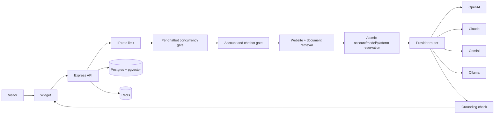
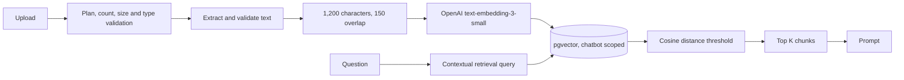
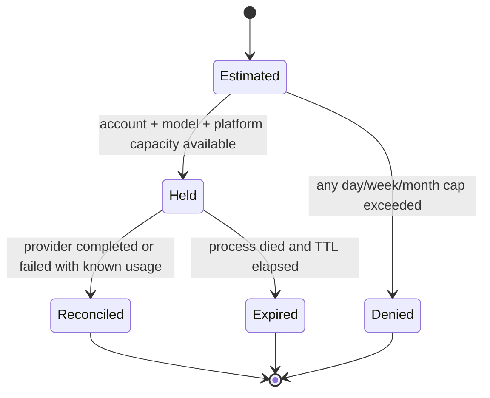
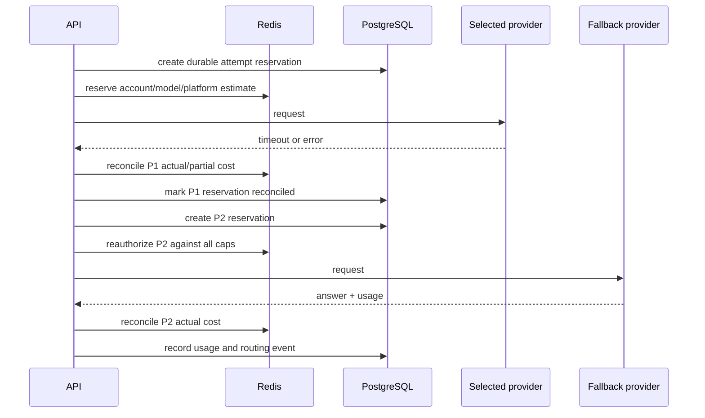
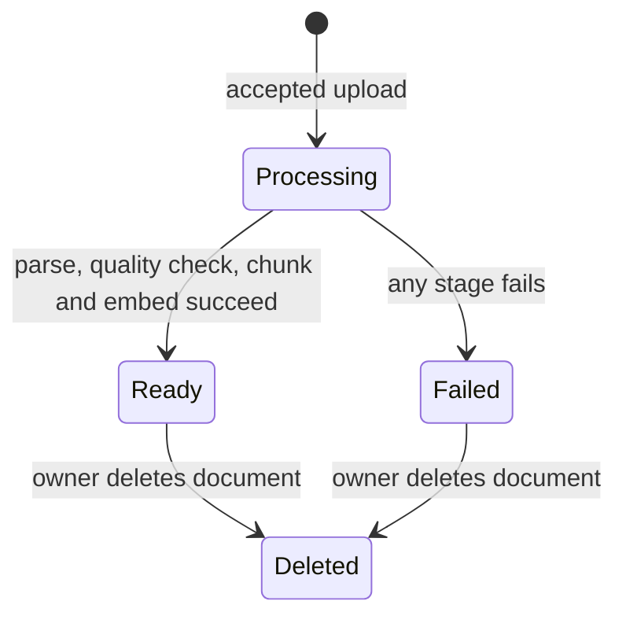

# ChatMate360 AI production-readiness specification

Status: implementation baseline and launch checklist. Numerical SLOs below are
proposed launch targets until production measurements validate them.

## 1. System architecture

## 2. Quota and reservation lifecycle

The plan's day, week, and month USD caps are shared at the account level across
all of its chatbots and providers. Per-chatbot/per-model and platform ceilings
remain additional safety boundaries. Monthly model top-ups increase the shared
monthly account cap by the purchased credit.

The reservation is estimated from input size, output allowance, and the selected
provider's configured token rates. The estimate is multiplied by a safety
factor and clamped between configured minimum and maximum values. Actual usage
reconciles the difference after every provider attempt.

Provider failure sequence:

Known limitation: account aggregate holds are Redis-backed and rebuilt from
recorded usage after cache expiry. The per-attempt and platform rows are durable.
If strict account-hold recovery becomes necessary, add an `account` reservation
scope and owner ID to the ledger.

## 3. Plans and economic boundaries

- Free: one chatbot, no document ingestion, configured account-wide caps.
- Crawl Plus: five chatbots, document ingestion, configured account-wide caps.
- Full Custom: contractual chatbot maximum and administrator-overridable caps.
- Plan values are USD AI-cost allowances, not token or message allowances.
- Provider rates must be checked against current vendor pricing before launch
  and whenever models change. `AI_PRICING_OVERRIDES_JSON` permits a rate update
  without code changes.
- Stripe top-up prices must exceed granted credit plus fees and desired margin.
  Grants are compared to configured sale prices (`TOPUP_SALE_USD`,
  `CRAWL_PLUS_SALE_USD`) and to Stripe cash at runtime. A misconfigured
  grant disables credit-granting only; the API stays up and `/health`
  reports `degraded`. See `docs/CREDIT_GRANT_INVARIANT.md`.
- Profit reports must separate observed average, P95, and contractual worst
  case. Do not label scenario estimates as production data.

## 4. Retrieval and conversation behavior

- Vector rows and searches are constrained by `chatbot_id`.
- Only documents in `ready` state participate.
- Results above `DOCUMENT_RETRIEVAL_MAX_DISTANCE` are discarded.
- Ambiguous short follow-ups include the two latest user questions in the
  retrieval query.
- Contextual answer-cache keys include that retrieval query, preventing a vague
  question such as "How much is it?" from reusing another visitor's context.
- The answer model receives the latest configured conversation turns plus the
  existing compacted question summary.
- Out-of-scope or unsupported questions return the chatbot fallback without an
  AI call.

Document state:

## 5. Isolation checklist

Required automated and manual checks before launch:

- Every document query includes `chatbot_id`; tested with two tenants containing
  distinctive sentinel text.
- Chatbot ownership checks guard list, upload, and delete operations.
- Public access validates the configured embedding origin.
- Answer, page, relevance, rate-limit, concurrency, usage, and routing keys
  include chatbot or account identity as appropriate.
- Admin routes require administrator authentication.
- Webhooks verify raw-body signatures before parsing.
- Logs and metrics do not contain document text, full questions, API keys,
  bearer tokens, or webhook secrets.
- Custom actions and backend links are tested for SSRF, redirect, DNS-rebinding,
  and response-size protections separately.

This checklist is not a security certification. A dedicated security review and
penetration test are required before claiming security assurance.

## 6. Proposed launch SLOs

- Availability: 99.9% monthly for public chat, excluding provider-wide outage.
- Latency: P50 below 3 seconds, P95 below 10 seconds, P99 below 20 seconds for
  non-tool answers.
- Busy rejection: return 503 with `Retry-After` within 2 seconds rather than
  allowing unbounded work.
- Provider timeout: 30 seconds; Ollama 120 seconds unless production overrides.
- Error rate: fewer than 1% internal 5xx responses over 15 minutes.
- Grounded success: at least 95% on the approved regression set.
- Unsupported-claim rate: below 1% on the approved regression set.

These targets become commitments only after load and quality tests demonstrate
that AWS and provider quotas can sustain them.

## 7. Observability

Structured logs now expose:

- `public-chat-completed`: chatbot ID, HTTP status, latency, AI/fallback
  outcome, and gate reason (including rejected and failed requests).
- `public-chat-rate-limited`: rate-limit rejection.
- `public-chat-concurrency-rejected`: backpressure rejection and observed count.
- Existing routing events: initial model, quota switch, provider failure, and
  fallback denial.
- Existing reservation and usage logs: estimate denial, actual usage, orphan
  expiration, and threshold alerts.

Production dashboards should derive:

- request count, 4xx/5xx rate, P50/P95/P99 latency;
- AI-generated, fallback, cost-cap, rate-limit, and busy percentages;
- spend and tokens by account, chatbot, model, and provider;
- provider timeout/failure/fallback rates;
- reservation holds, denials, reconciliation lag, and expired holds;
- document ingestion duration/failure and retrieved-chunk distance;
- Redis/Postgres latency and pool saturation.

Alert when:

- public-chat 5xx exceeds 1% for 15 minutes;
- P95 exceeds 10 seconds for 15 minutes;
- provider failure exceeds 10% for 10 minutes;
- busy responses exceed 5% for 10 minutes;
- held reservations exceed their TTL;
- platform daily/monthly spend reaches 80%, 90%, or 100%;
- Redis, PostgreSQL, or the crawl worker is unavailable.

## 8. Capacity testing

Do not project from registered users. Capacity depends on simultaneous active
requests and token size.

Run staged tests at 10, 50, 100, then 250 concurrent chat requests. For each
stage record:

- requests per second and completion rate;
- P50/P95/P99 latency;
- input/output tokens and cost per successful answer;
- provider 429/5xx/timeouts and fallback rate;
- API CPU/memory/event-loop lag;
- PostgreSQL pool use and query latency;
- Redis latency;
- 503 busy percentage.

Stop increasing load when an SLO fails. That point, with at least 30% headroom,
is the supported capacity of one deployment. Repeat after changing instance
size, replica count, provider tier, or concurrency settings.

## 9. Risk register

Critical:

- Incorrect/stale provider prices can invalidate margin controls. Mitigation:
  verify rates at launch and alert on unknown models.
- Atomic reservation and concurrency admission fail closed on Redis/ledger
  errors. Read-only pre-checks can still fail open, but the later reservation
  remains authoritative. Mitigation: alert immediately and operate Redis with
  high availability.

High:

- Provider rate limits can produce synchronized fallback load. Mitigation:
  bounded concurrency, provider-specific telemetry, exponential backoff, and a
  future circuit breaker.
- Inline document embedding can tie up an HTTP request. Mitigation: move
  ingestion to a worker before supporting large upload volume.
- Heuristic conversation compaction loses assistant facts. Mitigation: evaluate
  an explicit summary schema before replacing it with an AI summary.

Medium:

- Similarity threshold may need corpus-specific calibration.
- A tokenized concurrency slot can remain until its configured TTL after a
  crash; a later acquire prunes it atomically.
- Per-process log aggregation requires a production log/metrics backend.

## 10. Delivery roadmap

Implemented in this hardening pass:

- account-wide shared AI budget across chatbots and providers;
- adaptive cost reservations;
- contextual follow-up retrieval and context-safe answer caching;
- pgvector similarity threshold;
- distributed per-chatbot concurrency backpressure;
- structured public-chat latency/outcome events;
- regression tests for reservation economics and contextual retrieval.

Must complete before public launch:

- load test against production-like AWS, PostgreSQL, Redis, and provider tiers;
- calibrate plan prices/caps with measured average and P95 costs;
- calibrate the document-distance threshold with a labelled evaluation set;
- add cross-tenant sentinel tests and run a dedicated security review;
- configure dashboards and alerts from section 7;
- validate Stripe top-up price-to-credit margin;
- verify production env values rather than relying on defaults.

Next:

- provider circuit breakers and retry policy;
- async document-ingestion worker;
- measured AI quality suite and release gate;
- account-scope durable reservation rows if required by failure testing;
- explicit conversation expiry/message policy based on customer testing.

## 10b. WP-1.2 browser QA (required before merge/deploy)

- [ ] Usage panel: month tab is “Credits this month”; day/week say request pace, not credits.
- [ ] Monthly exhaustion: widget/preview shows top-up or upgrade copy (not “credits empty”).
- [ ] Day-only cap: visitor sees wait-and-retry copy; no “burst”; response is 429 with `Retry-After` / `retryAfterSeconds`.
- [ ] Top-up still raises only the monthly allowance.
- [ ] Upgrade CTA on Billing still starts Stripe Checkout.
- [ ] An older widget build still shows the monthly `text` body (does not crash on unknown `gateReason`).
- [ ] Short public 429s (≤ 8s `Retry-After`) auto-retry once in the current widget.

## 10c. WP-1.3 Stripe inbox (Phase 1)

Phase 1 processes verified Stripe events inline after persist (`verify → persist → process → 200`). Fully async `200` then worker processing is a Phase 3 change — see `docs/STRIPE_WEBHOOK_INBOX.md`.

- [ ] Apply `db/migrations/20260926_stripe_webhook_events.sql` (includes `last_attempt_at`).
- [ ] Set `STRIPE_INBOX_REPLAY_DELAY`, `STRIPE_INBOX_RETENTION_DAYS` (default 90), and keep the worker sweep running.
- [ ] `/health` `billing.stripeInbox` reports `unprocessed`, `failed`, `processing`, `duplicates`, `replayCount`, `avgProcessingMs`, `oldestAgeSeconds`.
- [ ] Send a Stripe test `checkout.session.completed` and confirm one inbox row plus one grant.

## 10d. WP-1.4 pgvector HNSW

See `docs/PGVECTOR_HNSW.md`. Snapshot before the production build. Run the CONCURRENTLY migration outside a transaction.

- [ ] `db/migrations/20260927_pgvector_hnsw.sql` applied; `/health` `retrieval.hnsw` is `{ documentChunks: true, productCatalog: true }`.
- [x] Local benchmark: Recall@5/10 = 100%, tenant leak = 0, p95 ≈ 50 ms on 400 vectors (`docs/PGVECTOR_HNSW.md`).
- [ ] Staging `EXPLAIN ANALYZE` of a tenant-scoped document lookup; record p95 before/after.
- [ ] Compare recall on 50 questions (targets: Recall@5 ≥ 95%, Recall@10 ≥ 98%); raise `PGVECTOR_HNSW_EF_SEARCH` if filtered neighbors drop.
- [ ] Watch IO during the build; rollback is `DROP INDEX CONCURRENTLY`.

## 11. Architecture decisions

ADR-001 — PostgreSQL pgvector instead of hosted File Search:

- Keeps tenant data, lifecycle, and retrieval policy in ChatMate360.
- Reuses the existing database and explicit `chatbot_id` scoping.
- Requires ChatMate360 to operate indexes, threshold calibration, and scaling.

ADR-002 — USD cost allowance instead of a token allowance:

- Makes different provider token prices comparable.
- Allows provider routing without exposing raw vendor token units.
- Requires accurate, versioned model rates.

ADR-003 — one shared account budget:

- Prevents plan cost from multiplying by number of chatbots and providers.
- Top-ups increase monthly account capacity while retaining per-model records.
- Per-chatbot/model ceilings remain defense in depth and reporting dimensions.

ADR-004 — bounded concurrency before queueing:

- A chatbot interaction is latency-sensitive; long queues provide poor UX.
- Excess demand receives a fast retryable 503.
- Add a short queue only if load tests show bounded concurrency alone wastes
  useful provider capacity.
